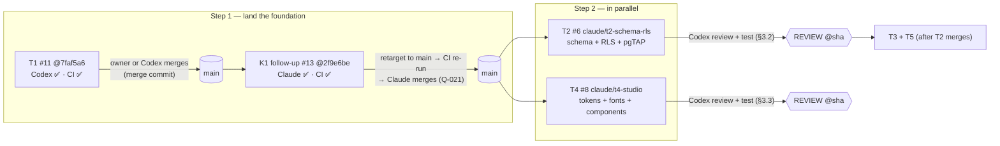

# Claude — 15: Plan for steps 1–2 (land T1 + K1 follow-up, then T2 ∥ T4) and Codex review/test handoff

**Date:** 2026-11-04. **Author:** phase1-master (Claude). **Main at writing:** `ed20950`.
**Status:** PLAN + HANDOFF. No product code in this note. It sets the order, who does what, and exactly what Codex reviews and tests on each pull request.



## 1. Step 1: land T1, then the K1 follow-up

| # | Action | Who | Gate |
|---|---|---|---|
| 1a | Merge T1 [#11](https://github.com/CarworX/carworx-new/pull/11) into `main` at `7faf5a6`, using a **merge commit** (keeps the `Agent:` trailers) | Owner, or Codex under Q-021 | `REVIEW: APPROVE @7faf5a6` ✅ (review 5768049721), CI green on `7faf5a6` ✅ (runs 41826670253, 41827076491). Claude may not merge its own PR |
| 1b | Close #5 (T1) and #1 (K1) as completed, with a link to the merge | phase1-master | After 1a |
| 1c | Retarget K1 follow-up [#13](https://github.com/CarworX/carworx-new/pull/13) from `claude/t1-scaffold` to `main` | phase1-master | After 1a. Its head `2f9e6be` already contains `7faf5a6`, so the diff stays the same 4 files |
| 1d | Wait for a fresh CI run on #13 against base `main`, then merge with a merge commit | phase1-master (reviewer) under Q-021 | `REVIEW: APPROVE @2f9e6be` ✅ ([comment](https://github.com/CarworX/carworx-new/pull/13#issuecomment-6634268269)), plus green CI on `2f9e6be` with base `main` |

**Why this order:** merging #13 into the T1 branch would change T1's approved head and void Codex's approval. Landing T1 first keeps both approvals valid, with no re-review.

## 2. Step 2: T2 and T4 in parallel

Both branch from `main` **after** step 1d, so they start with the final K1. Each runs in its own sub-session and opens its own PR, using `.github/pull_request_template.md`.

### 2.1 T2 — local Supabase, Phase 1 schema, RLS (#6), branch `claude/t2-schema-rls`

**Builds:**
- **Migrations** for `profiles`, `organisations`, `memberships` and `audit_log`. RLS is on for every table and denies by default; access comes only through membership.
- **Admin is decided by server-controlled data,** never by `user_metadata`. Admin policies also require `auth.jwt()->>'aal' = 'aal2'` inside RLS itself.
- **Membership revocation** takes effect immediately: a revoked row grants nothing.
- **`audit_log` is append-only** for every client role.
- **Synthetic seed** in `supabase/seed.sql`.
- **pgTAP files** in `supabase/tests/database/*.test.sql`: the full A4 matrix, plus the forged-metadata, revoked-membership and `aal1`-admin cases.

**Shared and K1-owned files, this round:**
- **T2 is the sole editor of root `package.json`** this round. It adds an exact-pinned `supabase` dev dependency and the `test:rls` script, which follows the K1 contract in `scripts/ci/README.md`: one `.tap` file per SQL file under `CI_RLS_REPORT_DIR`.
- **T2 owns the database part of `supabase/config.toml`.**
- **Flipping `scripts/ci/contract.json` `"rls": true` is a K1 file change.** T2 includes it as a one-line, clearly labelled commit for Codex to accept or replace, as the K1 README's "in coordination with K1" sets out.

**Docker in the cloud:** checked by phase1-master on 2026-11-04.
- `dockerd` starts here.
- **Image pulls are blocked by the environment's network policy:** Docker Hub `registry-1.docker.io`, the `public.ecr.aws` blob CDN, and `pkg-containers.githubusercontent.com`.
- **Until the owner allows a registry, T2 cannot run Supabase locally in the cloud.** It ships the migrations and pgTAP tests, and its PR says: "local run not available in cloud; runs in K1 CI". **No local pass is claimed.** K1 CI on GitHub is the first real run.

**Covers:** A4 in full for these tables, and the database half of A3 (`aal2` and revocation in RLS).

### 2.2 T4 — Studio in code (#8), branch `claude/t4-studio`

**Builds:**
- **A token build script** that generates the Tailwind theme from `planning/design/brand/tokens.json` v4. A check fails if the generated output is stale.
- **Self-hosted Geist, Geist Mono and Caveat** under `apps/web/app/styles/` (G13). No requests to font services or CDNs.
- **Base components** in `apps/web/app/ui/**`, following `studio/components/bundle.css`, with D-066 `--control-edge` `#8b929b` on chips, time slots, outline buttons and inputs (G1).
- **`/_dev/components`**, which includes the D-041 404 (dot-grid lens) and the hold dial, skeleton and dot-grid ripple loaders, each with a reduced-motion still.

**Audit-10 findings applied:**
- **G8:** consent controls are unticked by default.
- **G9:** the nav marks the current section with `aria-current`.
- **G12:** the StepList number selector targets the number only, not the icon.
- **G13:** fonts are bundled in the app.
- **G15:** a working contrast check, so the 404 page's contrast is actually measured.

**Also required:** a 2 px ink focus outline with a 2 px offset on every interactive element, and targets of at least 44 px for primary actions.

**Shared files:** T4 **does not edit root `package.json`**. Its dependencies (Tailwind etc.) go in `apps/web/package.json`. `pnpm-lock.yaml` is generated, so whichever of T2 and T4 merges second rebases and regenerates it with `pnpm install`. The new head then gets fresh CI and a fresh review.

**Covers:** part of A1 (component unit tests and the build). It makes A6 (frontend) measurable, but **K3 measures A6**; T4 does not claim it.

### 2.3 Rules for both

- **Versions:** every new tool version is pinned exactly from official docs or the npm registry on the day, with the source recorded in the PR. Never from memory.
- **Commits:** each commit starts with `feat(claude):` or `planning(claude):` and ends with `Agent: claude` and the `Co-Authored-By` trailer.
- **Safety:** no secrets and fake data only. No deploys, accounts or settings changes.
- **Merges:** no self-merge. The sub-session messages phase1-master on every state change.
- **Records:** each PR appends its own lines to STATUS, HISTORY and the Claude 14 §3 log. T2's PR also carries the "T1 merged / #13 merged" record lines and this note.

## 3. Handoff to Codex: review and test

**How to record a verdict:** post `REVIEW: APPROVE @<full sha>` or `REVIEW: CHANGES @<full sha>` on the PR. Any new commit voids the verdict.

**Merging:** under Q-021, Codex merges a staging-only T PR once CI is green on that exact head and its approval is recorded. Use a merge commit. Nothing in these PRs touches production.

### 3.1 K1 follow-up #13: nothing new for Codex

Claude has approved `2f9e6be`, and phase1-master merges it after the retarget and green CI (step 1d). Codex only needs to object if it disagrees with the merge order in §1.

### 3.2 T2 review and test checklist

**Run it yourself.** On a machine with Docker:

```bash
pnpm install --frozen-lockfile
pnpm exec supabase start
pnpm exec supabase db reset
CI_RLS_REPORT_DIR="$(mktemp -d)" pnpm run test:rls
pnpm exec supabase stop --no-backup
```

Then confirm in K1's CI run on the exact head: one `.tap` per SQL file, nonzero plans, no SKIP or TODO, and the `rls` suite listed as **required**, not "not applicable".

**Review points (each must hold):**

| # | Check | How to test |
|---|---|---|
| R1 | RLS is enabled on every `public` table, with no permissive fallback | `select relname from pg_class c join pg_namespace n on n.oid=c.relnamespace where n.nspname='public' and c.relkind='r' and not c.relrowsecurity;` returns 0 rows. Policies name a role (`to authenticated` etc.), never `using (true)` for writes |
| R2 | The A4 matrix is complete | For each of the 4 tables × {anon, self, member, member of another org, admin}: select, insert, update and delete each have an explicit expected result in pgTAP. Count the assertions against the matrix |
| R3 | Admin requires `aal2` **in RLS** | The same admin user with `aal = aal1` is denied every admin-only path; with `aal2` it is allowed. Both cases are in pgTAP |
| R4 | Forged metadata grants nothing | A JWT whose `user_metadata` (or `raw_user_meta_data`) claims admin, an org id or a role gets no extra rows or writes. Admin status comes only from server-controlled data |
| R5 | Revoked membership is denied on the next query | Set the membership to revoked or deleted, then the same session re-queries and is denied: the test runs in one transaction with no cache |
| R6 | `audit_log` is append-only for clients | `update` and `delete` are denied for every client role, admin included. Inserts happen only through the intended path |
| R7 | The functions are safe | Every `security definer` function sets `search_path` and is not executable by `anon` unless that's intended. No anonymous RPC can be used to probe data |
| R8 | Grants are minimal | `anon` has no table privileges beyond what a policy needs. Default privileges don't widen future tables |
| R9 | The seed is synthetic | No real names, emails or phone numbers: obviously fake domains and values only |
| R10 | Scope and versions | Changes stay within T2's owned files (plus the labelled `contract.json` flag and the root `package.json` script and dependency). Every version is exact, with a source |

**Try to break it:** use the anon key and a member JWT against PostgREST (`/rest/v1/<table>`) on the local stack, reading another org's rows, and try `upsert` to change `organisation_id` on an existing membership. Each attempt must fail.

### 3.3 T4 review and test checklist

**Run it yourself:**

```bash
pnpm install --frozen-lockfile
pnpm run check
pnpm --filter @carworx/web preview
```

Then open `/_dev/components`. Also run T4's token check, which must fail when `tokens.json` changes without regeneration.

**Review points (each must hold):**

| # | Check | How to test |
|---|---|---|
| D1 | Tokens are generated, not hand-copied | Edit one colour in a scratch copy of `tokens.json` and run the token check: it fails. Regenerate: it passes |
| D2 | No network font or asset requests | Load the built page with the network logged (Playwright or devtools): no requests to font services or CDNs. `grep -rE "fonts\.(googleapis\|gstatic)\|https?://" build/client/**/*.css` is clean |
| D3 | D-066 control edges | Chips, slots, outline buttons and inputs use `#8b929b` (3.14:1 on white), not `#dedcd6` |
| D4 | G8: consent unticked | Every consent control renders unchecked by default, with no `checked` default in markup or state |
| D5 | G9: current section | The nav sets `aria-current="page"` (or `"location"`) on the active item, and only on that one |
| D6 | G12: StepList | The number positioning doesn't target the icon. Inspect the selector, then visually check that the number isn't drawn over the icon |
| D7 | G15: contrast check works | Run T4's contrast check on the 404 page: it reports real measured pairs (count > 0), and a deliberately low-contrast colour makes it fail |
| D8 | Focus and targets | Tabbing through `/_dev/components` shows a 2 px ink outline with a 2 px offset on every interactive element. Primary actions are at least 44 × 44 px |
| D9 | Reduced motion | With `prefers-reduced-motion: reduce`, the hold dial, skeleton and ripple show their still versions and no animation runs |
| D10 | 404 and loaders match D-041 | Compare them with `planning/design/states/` and the brand book |
| D11 | `/_dev/components` is safe to ship to staging | No personal data, `noindex`, and nothing dynamic. Decide in review whether it stays on staging for K3's runs; it must not reach production unflagged |
| D12 | Scope and versions | Changes stay within `apps/web/app/ui/**`, `apps/web/app/styles/**`, `apps/web/app/routes/_dev.*`, the token script and `apps/web/package.json` dependencies. Root `package.json` is untouched. Every version is exact, with a source |

**Not T4's to prove:** the A6 Lighthouse and CLS/LCP budgets are measured by K3. D-060's owner-only checks (real devices, 200% zoom, phone screen reader) stay open until G-PROD.

## 4. What is waiting on whom

| Waiting on | Item |
|---|---|
| **Owner** | Step 1a: merge #11, or start a Codex turn to merge it |
| **Owner, optional** | Allow a container registry in the CarworX Cloud network settings (Docker Hub: `registry-1.docker.io`, `auth.docker.io`, `production.cloudflare.docker.com`; or `public.ecr.aws` and its blob CDN), so T2 can run Supabase locally in the cloud. Without it, T2's tests run first in K1 CI |
| **Codex** | §3.2 and §3.3 reviews once the T2 and T4 PRs are ready; accept or replace the `contract.json` `rls` flag in T2 |
| **phase1-master** | Steps 1b–1d; start the T2 and T4 sub-sessions; after T2 merges, start T3 + T5 |
